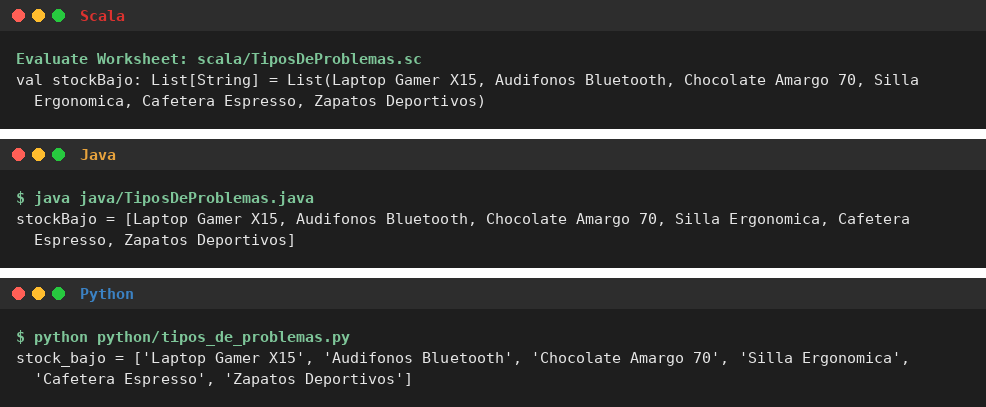
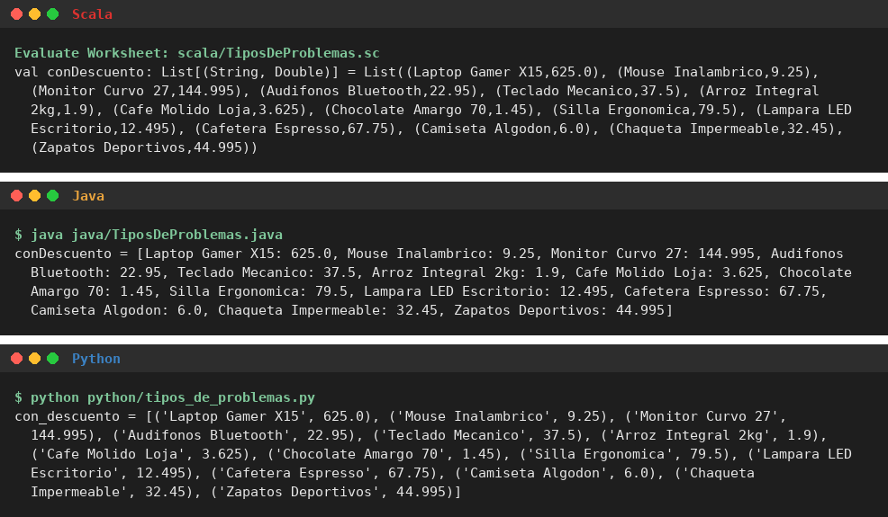
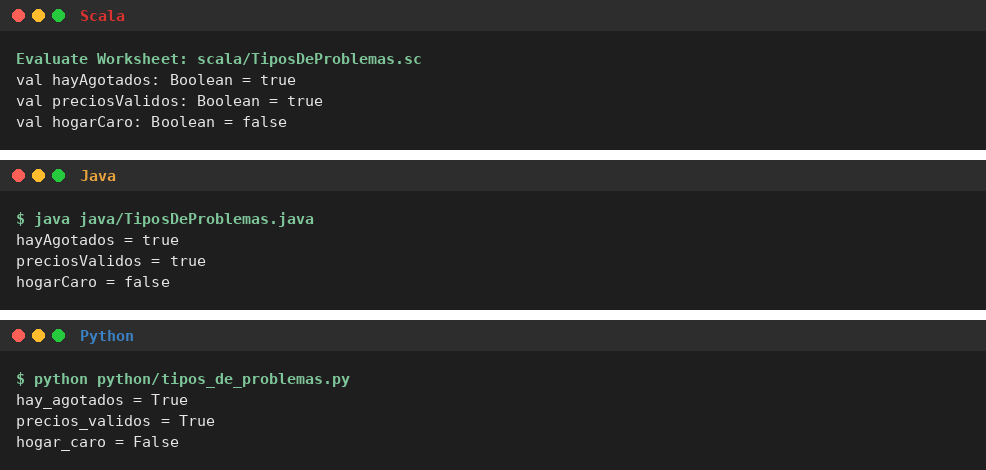
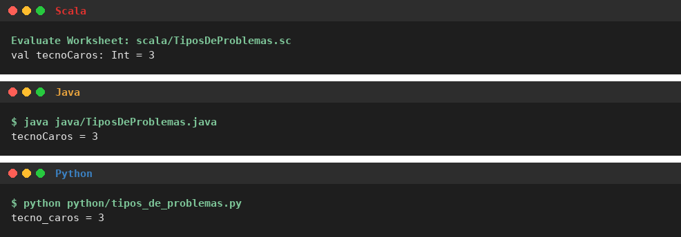
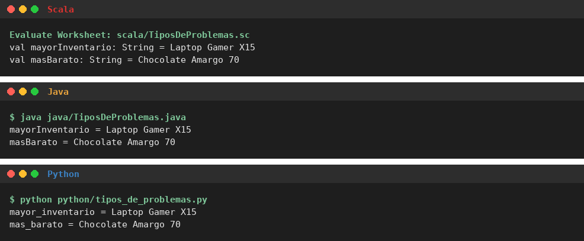
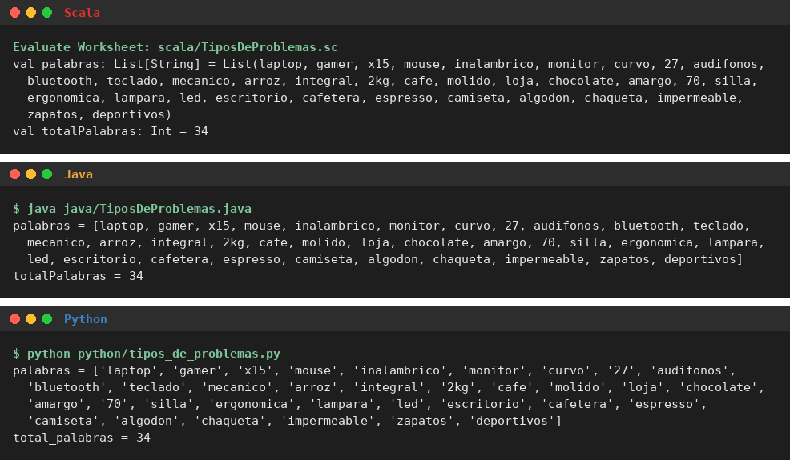
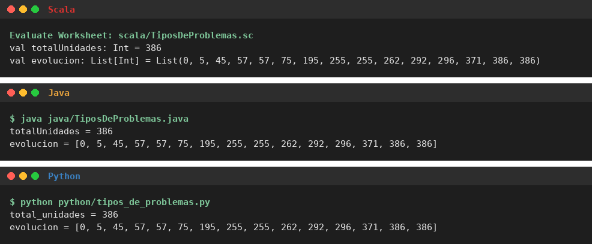
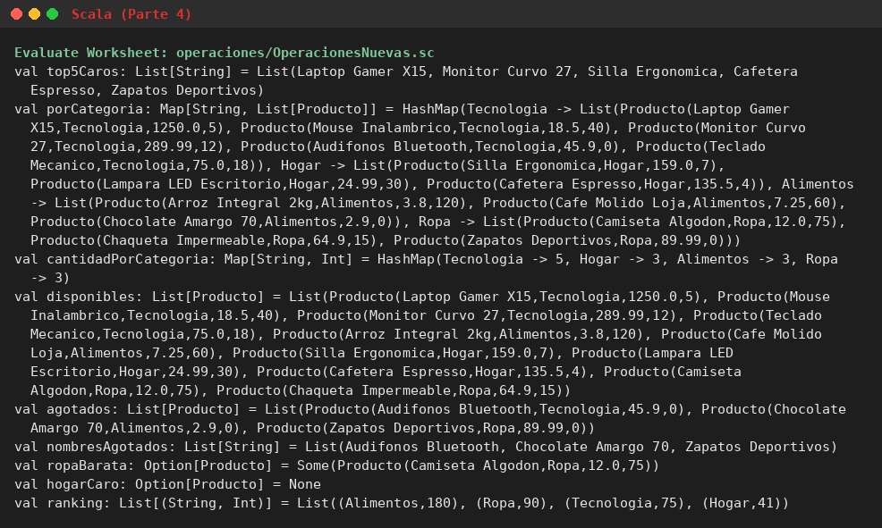

# Funciones Anónimas: Trabajo de Consulta

**Materia:** Programación Funcional y Reactiva  
**Lenguajes:** Scala, Java y Python  
**Autor:** Patricio Alexander Rivas Reinoso  
**Entrega:** Semana 5

> Este repositorio trata sobre las **funciones anónimas (lambdas)**: dónde se usan en sistemas reales, qué son, qué problemas resuelven sobre listas y cómo se escriben en Scala, Java y Python.

---

## Tabla de contenidos

- [Estructura del repositorio](#estructura)
- [Cómo ejecutar el código](#ejecutar)
- [Datos usados en todos los ejemplos](#datos)
- [Parte 1. Explorar: la programación funcional en el mundo real](#parte-1)
  - [Caso 1: Apache Spark](#caso-spark)
  - [Caso 2: Twitter y *Effective Scala*](#caso-twitter)
- [Parte 2. Entender: ¿qué es una función anónima?](#parte-2)
- [Parte 3. Aplicar: ¿en qué problemas sirven las funciones anónimas?](#parte-3)
  - [3.1 Catálogo de tipos de problemas](#p3-catalogo)
  - [1. Selección](#p3-seleccion) | [2. Transformación](#p3-transformacion) | [3. Validación](#p3-validacion) | [4. Conteo](#p3-conteo) | [5. Extremos](#p3-extremos) | [6. Aplanamiento](#p3-aplanamiento) | [7. Acumulación](#p3-acumulacion)
- [Parte 4. Ampliar: cuatro operaciones nuevas](#parte-4)
- [Parte 5. Comparar y concluir](#parte-5)
- [Referencias](#referencias)

---

<a id="estructura"></a>
## Estructura del repositorio

```
PFR-FuncionesAnonimas/
├── README.md                       <- documento principal (partes 1 a 5)
├── scala/
│   └── TiposDeProblemas.sc         <- Parte 3: los 7 tipos de problemas en Scala (worksheet)
├── java/
│   └── TiposDeProblemas.java       <- Parte 3: los 7 tipos de problemas en Java
├── python/
│   └── tipos_de_problemas.py       <- Parte 3: los 7 tipos de problemas en Python
├── operaciones/
│   └── OperacionesNuevas.sc        <- Parte 4: sortBy, groupBy, partition, find (worksheet)
└── img/                            <- capturas de ejecución
```

<a id="ejecutar"></a>
## Cómo ejecutar el código

Cada archivo funciona solo: ya trae la `case class Producto` y la lista de productos. Los archivos de Scala son **worksheets (`.sc`)**, como en clase: el código se escribe directo, sin `main`.

| Archivo | Requisito | Cómo ejecutarlo |
|---|---|---|
| `scala/TiposDeProblemas.sc` | Scala 3 | En IntelliJ: abrir el worksheet y pulsar el botón de ejecutar (*Evaluate Worksheet*). En consola: `scala-cli run scala/TiposDeProblemas.sc` |
| `java/TiposDeProblemas.java` | JDK 17 o superior | `java java/TiposDeProblemas.java` |
| `python/tipos_de_problemas.py` | Python 3.8 o superior | `python python/tipos_de_problemas.py` |
| `operaciones/OperacionesNuevas.sc` | Scala 3 | En IntelliJ: abrir el worksheet y pulsar el botón de ejecutar (*Evaluate Worksheet*). En consola: `scala-cli run operaciones/OperacionesNuevas.sc` |

> Las tres versiones de la Parte 3 dan **los mismos resultados**. Solo cambia cómo se muestran: el worksheet de Scala muestra cada `val` con su tipo, y Java y Python imprimen cada resultado con su nombre.

<a id="datos"></a>
## Datos usados en todos los ejemplos

Todos los ejemplos usan **la misma lista de 14 productos** de una tienda, guardada como `case class` (como en la clase B1S4):

```scala
case class Producto(nombre: String, categoria: String, precio: Double, stock: Int)
```

| # | nombre | categoria | precio (USD) | stock |
|---|---|---|---:|---:|
| 1 | Laptop Gamer X15 | Tecnologia | 1250.00 | 5 |
| 2 | Mouse Inalambrico | Tecnologia | 18.50 | 40 |
| 3 | Monitor Curvo 27 | Tecnologia | 289.99 | 12 |
| 4 | Audifonos Bluetooth | Tecnologia | 45.90 | 0 |
| 5 | Teclado Mecanico | Tecnologia | 75.00 | 18 |
| 6 | Arroz Integral 2kg | Alimentos | 3.80 | 120 |
| 7 | Cafe Molido Loja | Alimentos | 7.25 | 60 |
| 8 | Chocolate Amargo 70 | Alimentos | 2.90 | 0 |
| 9 | Silla Ergonomica | Hogar | 159.00 | 7 |
| 10 | Lampara LED Escritorio | Hogar | 24.99 | 30 |
| 11 | Cafetera Espresso | Hogar | 135.50 | 4 |
| 12 | Camiseta Algodon | Ropa | 12.00 | 75 |
| 13 | Chaqueta Impermeable | Ropa | 64.90 | 15 |
| 14 | Zapatos Deportivos | Ropa | 89.99 | 0 |

En Java se usa un `record Producto(...)` y en Python una `@dataclass`. Las dos, igual que la `case class`, no se pueden modificar una vez creadas (son inmutables).

---

<a id="parte-1"></a>
## Parte 1. Explorar: la programación funcional en el mundo real

<a id="caso-spark"></a>
### Caso 1: Apache Spark

| Aspecto | Detalle |
|---|---|
| **Qué problema resuelve** | Procesar cantidades enormes de datos (registros de páginas web, transacciones, etc.) que no caben en una sola computadora, repartiendo el trabajo entre muchas máquinas. |
| **Lenguaje / herramienta** | Spark está escrito en **Scala**, y también se puede usar desde Java y Python. |
| **Ventaja del enfoque funcional** | El programador no escribe ciclos: le pasa a Spark lambdas con lo que hay que hacer con cada dato (`map`, `filter`, `flatMap`, `reduce`). Como esas lambdas son funciones puras (no cambian variables de afuera), Spark puede ejecutarlas al mismo tiempo en muchas máquinas sin que se estorben. |
| **Fuente** | Documentación oficial: *Spark Quick Start* - https://spark.apache.org/docs/latest/quick-start.html |

**Fragmento de código real** (de la guía *Quick Start* de Spark):

```scala
// ¿Cuántas palabras tiene la línea más larga del archivo?
textFile.map(line => line.split(" ").size).reduce((a, b) => if (a > b) a else b)

// Contar palabras
val wordCounts = textFile.flatMap(line => line.split(" ")).groupByKey(identity).count()
```

**Qué hace:**
- `map(line => line.split(" ").size)`: la lambda convierte cada línea en su número de palabras.
- `reduce((a, b) => if (a > b) a else b)`: la lambda compara dos números y se queda con el mayor; al repetirlo con toda la lista sale el máximo.
- `flatMap(line => line.split(" "))`: cada línea da varias palabras y `flatMap` las junta en una sola lista. Luego se cuentan las palabras iguales.

Este ejemplo inspiró el problema de [aplanamiento](#p3-aplanamiento) de la Parte 3.

<a id="caso-twitter"></a>
### Caso 2: Twitter y *Effective Scala*

| Aspecto | Detalle |
|---|---|
| **Qué problema resuelve** | Atender millones de usuarios con muchos servicios que trabajan juntos (publicar tweets, mostrar el timeline, buscar, etc.). |
| **Lenguaje / herramienta** | **Scala**. Twitter publicó su guía interna de buenas prácticas, llamada *Effective Scala*. |
| **Ventaja del enfoque funcional** | La guía recomienda trabajar con valores inmutables y transformarlos con funciones en lugar de modificarlos. Así el código es más fácil de entender, y varios procesos pueden usar los mismos datos al mismo tiempo sin peligro de que alguien los cambie. |
| **Fuente** | Eriksen, M. *Effective Scala*, Twitter - https://twitter.github.io/effectivescala/ |

**Fragmento de código real** (sección *Collections* de *Effective Scala*):

```scala
val votes = Seq(("scala", 1), ("java", 4), ("scala", 10), ("scala", 1), ("python", 10))
val orderedVotes = votes
  .groupBy(_._1)
  .map { case (which, counts) =>
    (which, counts.foldLeft(0)(_ + _._2))
  }.toSeq
  .sortBy(_._2)
  .reverse
```

Al ejecutarlo se obtiene `List((scala,12), (python,10), (java,4))`.

**Qué hace:** cuenta votos por lenguaje. Cada voto es una tupla `(lenguaje, cantidad)`.
1. `groupBy(_._1)` junta las tuplas que tienen el mismo lenguaje (`_._1` es el primer elemento de la tupla).
2. `map` recorre cada grupo y, con `foldLeft`, suma las cantidades (`_._2`, el segundo elemento).
3. `sortBy(_._2)` ordena por total y `reverse` deja primero al más votado.

Es el mismo patrón agrupar, sumar y ordenar que uso en la [combinación de la Parte 4](#p4-combinacion).

---

<a id="parte-2"></a>
## Parte 2. Entender: ¿qué es una función anónima?

### 2.1 ¿Qué es una función anónima y de dónde viene el nombre *lambda*?

Una función anónima es una **función que no tiene nombre**. Se escribe directamente donde se va a usar, solo con sus parámetros, la flecha `=>` y lo que devuelve. Sirve cuando la operación es corta y se usa una sola vez.

```scala
(x: Int) => x * x      // recibe un número y devuelve su cuadrado
```

El nombre *lambda* viene del **cálculo lambda (λ)**, un sistema matemático que creó **Alonzo Church** en los años 1930 para estudiar las funciones. Ahí una función se escribe sin nombre usando la letra griega λ, por ejemplo `λx. x * x`. Por eso varios lenguajes llaman *lambda* a estas funciones (Python incluso usa la palabra `lambda`).

### 2.2 ¿En qué se diferencia de una función nombrada?

Una función nombrada se declara aparte con `def`, tiene nombre y se puede usar muchas veces. Una función anónima se escribe en el mismo lugar donde se usa.

```scala
// Función nombrada
def esCaro(p: Producto): Boolean = p.precio > 100
productos.filter(esCaro)

// Función anónima: la misma idea, sin nombre
productos.filter(p => p.precio > 100)
productos.filter(_.precio > 100)        // forma corta con _
```

Si la lógica se repite o es larga, conviene la función nombrada; si es corta y se usa una vez, la anónima.

### 2.3 ¿Qué significa que las funciones sean *ciudadanos de primera clase*?

Que una función se trata **como cualquier otro valor** (como un `Int` o un `String`): se puede guardar en un `val` y pasar como argumento a otra función.

```scala
val cuadrado = (x: Int) => x * x       // guardada en un val
cuadrado(4)                            // 16

val esCaro: Producto => Boolean = p => p.precio > 100
productos.filter(esCaro)               // pasada como argumento
```

Por eso se puede pasar una lambda a `map` o `filter`: son **funciones de orden superior**, es decir, funciones que reciben otra función como parámetro. Por ejemplo, `filter` necesita una función que reciba un `Producto` y devuelva `Boolean` (`Producto => Boolean`), y la lambda `p => p.precio > 100` es justo eso.

### 2.4 ¿Qué es un *closure*?

Un closure es una función anónima que **usa una variable que está definida fuera de ella**.

```scala
val iva = 0.15                                     // variable de afuera
val precioConIva = (p: Producto) => p.precio * (1 + iva)

productos.map(precioConIva)
```

La lambda no recibe `iva` como parámetro: lo "toma" de afuera y lo recuerda. Como `iva` es un `val` (no cambia), la función sigue siendo pura: siempre da el mismo resultado para el mismo producto.

---

<a id="parte-3"></a>
## Parte 3. Aplicar: ¿en qué problemas sirven las funciones anónimas?

Se resolvieron **los 7 tipos de problemas** con la lista de [productos](#datos). El código completo está en [`scala/TiposDeProblemas.sc`](scala/TiposDeProblemas.sc), [`java/TiposDeProblemas.java`](java/TiposDeProblemas.java) y [`python/tipos_de_problemas.py`](python/tipos_de_problemas.py). Aquí se muestra la línea principal de cada solución y el resultado.

En Scala no se usa `println`: en el worksheet basta con guardar el resultado en un `val` y IntelliJ muestra su valor a la derecha. En Java y Python sí hace falta imprimir.

<a id="p3-catalogo"></a>
### 3.1 Catálogo de tipos de problemas

| # | Tipo | Pregunta que responde | Scala | Java | Python |
|---|---|---|---|---|---|
| 1 | [Selección](#p3-seleccion) | ¿Qué elementos cumplen una condición? | `filter` | `filter` | `filter` |
| 2 | [Transformación](#p3-transformacion) | ¿Cómo convierto cada elemento en otro valor? | `map` | `map` | `map` |
| 3 | [Validación](#p3-validacion) | ¿Hay alguno que cumpla? ¿Todos cumplen? | `exists`, `forall` | `anyMatch`, `allMatch` | `any`, `all` |
| 4 | [Conteo](#p3-conteo) | ¿Cuántos cumplen una condición? | `count` | `filter` + `count` | `len` + `filter` |
| 5 | [Extremos](#p3-extremos) | ¿Cuál es el mayor o el menor según un criterio? | `maxBy`, `minBy` | `max`, `min` | `max`, `min` con `key` |
| 6 | [Aplanamiento](#p3-aplanamiento) | ¿Cómo junto en una lista lo que da cada elemento? | `flatMap` | `flatMap` | `reduce` |
| 7 | [Acumulación](#p3-acumulacion) | ¿Qué valor resume toda la lista? | `foldLeft`, `scanLeft` | `reduce` | `reduce`, `accumulate` |

Capturas de la ejecución completa: [Scala](img/parte3_scala_completa.png) | [Java](img/parte3_java_completa.png) | [Python](img/parte3_python_completa.png).

---

<a id="p3-seleccion"></a>
### 1. Selección: `filter`

**Situación real:** el encargado de bodega necesita saber qué productos tienen **menos de 10 unidades** para pedirlos al proveedor.

```scala
// Scala
val stockBajo = productos.filter(p => p.stock < 10).map(p => p.nombre)
```

```java
// Java
List<String> stockBajo = productos.stream()
    .filter(p -> p.stock() < 10)
    .map(p -> p.nombre())
    .toList();
```

```python
# Python
stock_bajo = list(map(lambda p: p.nombre, filter(lambda p: p.stock < 10, productos)))
```

**Resultado en el worksheet de Scala:**

```
val stockBajo: List[String] = List(Laptop Gamer X15, Audifonos Bluetooth, Chocolate Amargo 70, Silla Ergonomica, Cafetera Espresso, Zapatos Deportivos)
```



---

<a id="p3-transformacion"></a>
### 2. Transformación: `map`

**Situación real:** la tienda hace una **liquidación con 50 % de descuento** y necesita el nuevo precio de cada producto.

```scala
// Scala: cada producto se convierte en una tupla (nombre, precio con descuento)
val conDescuento = productos.map(p => (p.nombre, p.precio * 0.5))
```

```java
// Java
List<String> conDescuento = productos.stream()
    .map(p -> p.nombre() + ": " + p.precio() * 0.5)
    .toList();
```

```python
# Python
con_descuento = list(map(lambda p: (p.nombre, p.precio * 0.5), productos))
```

**Resultado en el worksheet de Scala:**

```
val conDescuento: List[(String, Double)] = List((Laptop Gamer X15,625.0), (Mouse Inalambrico,9.25), (Monitor Curvo 27,144.995), (Audifonos Bluetooth,22.95), (Teclado Mecanico,37.5), (Arroz Integral 2kg,1.9), (Cafe Molido Loja,3.625), (Chocolate Amargo 70,1.45), (Silla Ergonomica,79.5), (Lampara LED Escritorio,12.495), (Cafetera Espresso,67.75), (Camiseta Algodon,6.0), (Chaqueta Impermeable,32.45), (Zapatos Deportivos,44.995))
```



---

<a id="p3-validacion"></a>
### 3. Validación: `exists` / `forall`

**Situación real:** antes de publicar el catálogo en la tienda en línea se revisa si **hay productos agotados** y si **todos tienen un precio mayor que cero**. También se pregunta si hay algún producto de Hogar de más de $200.

```scala
// Scala
val hayAgotados = productos.exists(p => p.stock == 0)
val preciosValidos = productos.forall(p => p.precio > 0)
val hogarCaro = productos.exists(p => p.categoria == "Hogar" && p.precio > 200)
```

```java
// Java
boolean hayAgotados = productos.stream().anyMatch(p -> p.stock() == 0);
boolean preciosValidos = productos.stream().allMatch(p -> p.precio() > 0);
boolean hogarCaro = productos.stream().anyMatch(p -> p.categoria().equals("Hogar") && p.precio() > 200);
```

```python
# Python
hay_agotados = any(map(lambda p: p.stock == 0, productos))
precios_validos = all(map(lambda p: p.precio > 0, productos))
hogar_caro = any(map(lambda p: p.categoria == "Hogar" and p.precio > 200, productos))
```

**Resultado en el worksheet de Scala:**

```
val hayAgotados: Boolean = true
val preciosValidos: Boolean = true
val hogarCaro: Boolean = false
```



---

<a id="p3-conteo"></a>
### 4. Conteo: `count`

**Situación real:** el gerente quiere saber **cuántos productos de Tecnología cuestan más de $50** para organizar la vitrina.

```scala
// Scala
val tecnoCaros = productos.count(p => p.categoria == "Tecnologia" && p.precio > 50)
```

```java
// Java: count() no recibe lambda, por eso primero se filtra
long tecnoCaros = productos.stream()
    .filter(p -> p.categoria().equals("Tecnologia") && p.precio() > 50)
    .count();
```

```python
# Python: se cuenta cuántos deja pasar filter
tecno_caros = len(list(filter(lambda p: p.categoria == "Tecnologia" and p.precio > 50, productos)))
```

**Resultado en el worksheet de Scala:**

```
val tecnoCaros: Int = 3
```



---

<a id="p3-extremos"></a>
### 5. Extremos: `maxBy` / `minBy`

**Situación real:** se quiere saber qué producto tiene **más dinero guardado en bodega** (precio x stock) para asegurarlo, y cuál es el **más barato** para usarlo en una promoción.

```scala
// Scala
val mayorInventario = productos.maxBy(p => p.precio * p.stock).nombre
val masBarato = productos.minBy(p => p.precio).nombre
```

```java
// Java: max y min reciben una lambda que compara DOS productos
String mayorInventario = productos.stream()
    .max((a, b) -> Double.compare(a.precio() * a.stock(), b.precio() * b.stock()))
    .get().nombre();
String masBarato = productos.stream()
    .min((a, b) -> Double.compare(a.precio(), b.precio()))
    .get().nombre();
```

```python
# Python: key= recibe la lambda con el criterio
mayor_inventario = max(productos, key=lambda p: p.precio * p.stock).nombre
mas_barato = min(productos, key=lambda p: p.precio).nombre
```

**Resultado en el worksheet de Scala:**

```
val mayorInventario: String = Laptop Gamer X15
val masBarato: String = Chocolate Amargo 70
```



---

<a id="p3-aplanamiento"></a>
### 6. Aplanamiento: `flatMap`

**Situación real:** el buscador de la tienda necesita una **lista de palabras clave** sacadas de los nombres de los productos. Cada producto da *varias* palabras y todas deben quedar en una sola lista (como en el ejemplo de [Spark](#caso-spark)).

```scala
// Scala
val palabras = productos.flatMap(p => p.nombre.toLowerCase.split(" "))
val totalPalabras = palabras.size
```

```java
// Java: la lambda debe devolver un Stream
List<String> palabras = productos.stream()
    .flatMap(p -> Arrays.stream(p.nombre().toLowerCase().split(" ")))
    .toList();
```

```python
# Python no tiene flatMap: con reduce se van juntando las palabras de cada producto
palabras = reduce(lambda acc, p: acc + p.nombre.lower().split(" "), productos, [])
```

**Resultado en el worksheet de Scala:**

```
val palabras: List[String] = List(laptop, gamer, x15, mouse, inalambrico, monitor, curvo, 27, audifonos, bluetooth, teclado, mecanico, arroz, integral, 2kg, cafe, molido, loja, chocolate, amargo, 70, silla, ergonomica, lampara, led, escritorio, cafetera, espresso, camiseta, algodon, chaqueta, impermeable, zapatos, deportivos)
val totalPalabras: Int = 34
```

Si se usara `map` en vez de `flatMap`, el resultado sería una lista de 14 listas. `flatMap` hace el `map` y además aplana (como `map` + `flatten`).



---

<a id="p3-acumulacion"></a>
### 7. Acumulación: `foldLeft` / `scanLeft`

**Situación real:** el encargado de bodega necesita el **total de unidades** que hay en bodega y también quiere ver **cómo va creciendo ese total** producto por producto (como el saldo de una cuenta en la clase B1S4).

```scala
// Scala
val totalUnidades = productos.foldLeft(0)((acc, p) => acc + p.stock)
val evolucion = productos.scanLeft(0)((acc, p) => acc + p.stock)
```

```java
// Java: reduce hace lo mismo que foldLeft
int totalUnidades = productos.stream()
    .map(p -> p.stock())
    .reduce(0, (acc, s) -> acc + s);

// Java no tiene scanLeft: para cada posición i se suman las unidades de los primeros i productos
List<Integer> evolucion = IntStream.rangeClosed(0, productos.size())
    .mapToObj(i -> productos.subList(0, i).stream().map(p -> p.stock()).reduce(0, (acc, s) -> acc + s))
    .toList();
```

```python
# Python: reduce = foldLeft, accumulate = scanLeft
total_unidades = reduce(lambda acc, p: acc + p.stock, productos, 0)
evolucion = list(accumulate(productos, lambda acc, p: acc + p.stock, initial=0))
```

**Resultado en el worksheet de Scala:**

```
val totalUnidades: Int = 386
val evolucion: List[Int] = List(0, 5, 45, 57, 57, 75, 195, 255, 255, 262, 292, 296, 371, 386, 386)
```

El último número de `scanLeft` es igual al resultado de `foldLeft` (386). Los números repetidos son de productos agotados, que suman 0.



---

<a id="parte-4"></a>
## Parte 4. Ampliar: cuatro operaciones nuevas

Código: [`operaciones/OperacionesNuevas.sc`](operaciones/OperacionesNuevas.sc), con la misma lista de [productos](#datos).

### 4.1 Operaciones elegidas

| Familia | Operación | ¿Qué devuelve? |
|---|---|---|
| Ordenar | `sortBy` | Una lista nueva ordenada |
| Agrupar | `groupBy` | Un `Map` (cada clave con su lista de elementos) |
| Dividir una lista | `partition` | Una tupla con dos listas |
| Buscar | `find` | `Some(elemento)` o `None` |

### 4.2 Fichas

#### Ficha 1: `sortBy`

1. **Qué hace:** ordena la lista de menor a mayor según un valor que calcula la lambda. Es parecido a `sorted`, visto en clase, pero con `sortBy` uno elige por qué campo ordenar.
2. **Qué lambda recibe:** una que devuelve la **clave** para ordenar: `p => p.precio`. Con el signo menos (`p => -p.precio`) se ordena de mayor a menor.
3. **Ejemplo:**
   ```scala
   val top5Caros = productos.sortBy(p => -p.precio).take(5).map(p => p.nombre)
   ```
   ```
   val top5Caros: List[String] = List(Laptop Gamer X15, Monitor Curvo 27, Silla Ergonomica, Cafetera Espresso, Zapatos Deportivos)
   ```
4. **Qué problema resuelve:** mostrar productos "de mayor a menor precio" o hacer un top 5. Se parece a [Extremos](#p3-extremos): `maxBy` da solo el mayor y `sortBy` ordena toda la lista.

#### Ficha 2: `groupBy`

1. **Qué hace:** separa los elementos en grupos según una clave.
2. **Qué lambda recibe:** una que devuelve la **clave del grupo**: `p => p.categoria`. Devuelve un `Map` donde cada categoría tiene su lista de productos. Al recorrerlo, cada grupo es una tupla: `g._1` es la categoría y `g._2` la lista.
3. **Ejemplo:**
   ```scala
   val porCategoria = productos.groupBy(p => p.categoria)
   val cantidadPorCategoria = porCategoria.map(g => (g._1, g._2.size))
   ```
   ```
   val cantidadPorCategoria: Map[String, Int] = HashMap(Tecnologia -> 5, Hogar -> 3, Alimentos -> 3, Ropa -> 3)
   ```
4. **Qué problema resuelve:** reportes por categoría, por mes o por ciudad. Es un tipo de problema nuevo (**Agrupación**) que no estaba en la tabla de la Parte 3.

#### Ficha 3: `partition`

1. **Qué hace:** divide la lista en dos: los que cumplen la condición y los que no.
2. **Qué lambda recibe:** una condición (devuelve `Boolean`): `p => p.stock > 0`. Devuelve una **tupla** `(cumplen, noCumplen)` que se puede separar en dos `val` de una vez.
3. **Ejemplo:**
   ```scala
   val (disponibles, agotados) = productos.partition(p => p.stock > 0)
   val nombresAgotados = agotados.map(p => p.nombre)
   ```
   ```
   val nombresAgotados: List[String] = List(Audifonos Bluetooth, Chocolate Amargo 70, Zapatos Deportivos)
   ```
   La lista `disponibles` tiene los otros 11 productos.
4. **Qué problema resuelve:** separar aprobados y reprobados, pagos aceptados y rechazados, etc. Es como [Selección](#p3-seleccion) (`filter`), pero sin perder los que no cumplen.

#### Ficha 4: `find`

1. **Qué hace:** busca el **primer** elemento que cumple una condición.
2. **Qué lambda recibe:** una condición: `p => p.categoria == "Ropa" && p.precio < 20`. Si lo encuentra devuelve `Some(elemento)`, y si no hay ninguno devuelve `None` (así no hay error cuando no existe).
3. **Ejemplo:**
   ```scala
   val ropaBarata = productos.find(p => p.categoria == "Ropa" && p.precio < 20)
   val hogarCaro = productos.find(p => p.categoria == "Hogar" && p.precio > 200)
   ```
   ```
   val ropaBarata: Option[Producto] = Some(Producto(Camiseta Algodon,Ropa,12.0,75))
   val hogarCaro: Option[Producto] = None
   ```
4. **Qué problema resuelve:** buscar un cliente por su cédula o un producto por su código. Se parece a [Validación](#p3-validacion): `exists` solo dice *si hay* uno, mientras que `find` dice *cuál es*.

Captura de la ejecución de la Parte 4:



<a id="p4-combinacion"></a>
### 4.3 Combinar operaciones

**Pregunta:** *¿qué categoría tiene más unidades en bodega?*

```scala
val ranking = productos
  .groupBy(p => p.categoria)
  .toList
  .map(g => (g._1, g._2.foldLeft(0)((acc, p) => acc + p.stock)))
  .sortBy(t => -t._2)
```

**Resultado en el worksheet de Scala:**

```
val ranking: List[(String, Int)] = List((Alimentos,180), (Ropa,90), (Tecnologia,75), (Hogar,41))
```

**Qué hace cada paso:**

1. **`groupBy` (nueva):** junta los productos por categoría (4 grupos).
2. **`toList`:** convierte el `Map` en una lista de tuplas `(categoria, productos)` para poder ordenarla.
3. **`map` + `foldLeft` (vistas en clase):** cada tupla se convierte en `(categoria, total de unidades)`. `foldLeft` suma el `stock` de los productos de ese grupo.
4. **`sortBy` (nueva):** ordena por el total (`t._2`) de mayor a menor, gracias al signo menos.

Resultado: Alimentos es la categoría con más unidades en bodega (180). Se usaron **dos operaciones nuevas** (`groupBy`, `sortBy`) y **dos vistas en clase** (`map`, `foldLeft`).

---

<a id="parte-5"></a>
## Parte 5. Comparar y concluir

### 5.1 Scala, Java y Python frente a frente

Comparación basada en las soluciones de la [Parte 3](#parte-3).

| Criterio | Scala | Java | Python |
|---|---|---|---|
| **Sintaxis de la lambda** | `p => p.stock < 10` o la forma corta `_.stock < 10` | `p -> p.stock() < 10` (flecha `->`) | `lambda p: p.stock < 10` |
| **Cómo se declara el tipo** | Normalmente no hace falta, Scala lo deduce. Se puede escribir: `(p: Producto) => ...`. El tipo de la función se escribe `Producto => Boolean`. | No se escribe en la lambda; Java lo deduce según el método donde se usa (por ejemplo `filter` espera una condición). | No se declara: Python tiene tipos dinámicos. |
| **Operaciones con listas disponibles** | Todas directamente en la lista: `filter`, `map`, `exists`, `forall`, `count`, `maxBy`, `minBy`, `flatMap`, `foldLeft`, `scanLeft`. | Hay que usar `.stream()` antes y `.toList()` al final. Algunos nombres cambian (`anyMatch`, `allMatch`) y faltan otros (`count` con condición, `maxBy`, `scanLeft`). | `map`, `filter`, `any`, `all`, `max`, `min`, y en módulos aparte `reduce` y `accumulate`. No tiene `flatMap` ni `count` con condición. `map` y `filter` hay que pasarlos a `list(...)`. |
| **Restricción del lenguaje** | Casi ninguna. Solo hay que tener cuidado de no abusar del `_` porque puede ser difícil de leer. | Una lambda no puede cambiar el valor de una variable local de afuera (la variable debe ser *effectively final*, es decir, no reasignarse). | La lambda solo puede tener **una expresión** en una línea: no se pueden poner varias instrucciones, asignaciones ni ciclos. |
| **Legibilidad (mi opinión)** | La más clara: el código se lee casi como la pregunta. | Se entiende, pero es más largo por `stream()`, `toList()` y los paréntesis de `p.precio()`. | Muy clara en casos simples como `max(..., key=...)`, pero `len(list(filter(lambda ...)))` se lee de adentro hacia afuera. |

**¿En qué lenguaje fue más natural resolver los problemas?**
En **Scala**. Todas las operaciones que vimos en clase existen con el mismo nombre directamente en `List`, así que cada problema se resolvió en una línea con una lambda corta. En Java hubo que cambiar algunos nombres (`exists` pasa a ser `anyMatch`) y en Python combinar funciones (por ejemplo `len(list(filter(...)))` para contar).

**¿En qué tipo de problema hubo más diferencias y por qué?**
En la **[Acumulación](#p3-acumulacion)**. En Scala, `foldLeft` y `scanLeft` ya existen. En Python existen como `reduce` y `accumulate`, pero hay que importarlos. En **Java no existe `scanLeft`**: tuve que armarlo sumando, para cada posición, los primeros valores de la lista con `reduce`. También hubo diferencias en el **[Aplanamiento](#p3-aplanamiento)**: en Java la lambda de `flatMap` debe devolver un `Stream`, y Python no tiene `flatMap`, así que usé `reduce` para ir juntando las listas.

### 5.2 Conclusión

Las funciones anónimas permiten separar dos cosas: la operación (`filter`, `map`, `foldLeft`) se encarga de **recorrer la lista**, y la lambda dice **qué hacer con cada elemento**. Gracias a eso resolví los siete tipos de problemas de la [Parte 3](#parte-3) sin ciclos ni variables que cambien, como se pide en la programación funcional. Además, si cambia la pregunta (por ejemplo "menos de 10 unidades" por "menos de 20"), solo se cambia la lambda y no todo el programa. Y como las operaciones se pueden encadenar ([Parte 4](#p4-combinacion)), problemas más grandes se resuelven en pasos pequeños y fáciles de leer.

Esto es justamente lo que aprovecha **[Apache Spark](#caso-spark)**: como las lambdas que se le pasan a `map`, `flatMap` o `reduce` son funciones puras, Spark puede ejecutarlas al mismo tiempo en muchas máquinas con millones de datos. Mi ejemplo de palabras clave usa la misma idea que el conteo de palabras de Spark; la diferencia es solo la cantidad de datos. Por eso las lambdas no son solo una forma corta de escribir, sino la base de cómo se procesan datos en sistemas reales.

---

<a id="referencias"></a>
## Referencias

1. Apache Software Foundation. *Quick Start, Spark Documentation*. https://spark.apache.org/docs/latest/quick-start.html
2. Eriksen, M. *Effective Scala*. Twitter. https://twitter.github.io/effectivescala/
3. Diapositivas de clase de la asignatura: *B1S1 Paradigmas de programación*, *B1S2 Funciones*, *B1S3 Funciones de orden superior* y *B1S4 Estructuras de datos*. https://slides.com/lsantiago
4. Documentación oficial de Scala 3. https://docs.scala-lang.org
5. Oracle. *Lambda Expressions, The Java Tutorials*. https://docs.oracle.com/javase/tutorial/java/javaOO/lambdaexpressions.html
6. Python Software Foundation. *Functional Programming HOWTO*. https://docs.python.org/3/howto/functional.html
7. Alama, J. y Korbmacher, J. *The Lambda Calculus*. Stanford Encyclopedia of Philosophy. https://plato.stanford.edu/entries/lambda-calculus/
8. Winitzki, S. (2024). *The Science of Functional Programming*. https://github.com/winitzki/sofp
9. **Uso de herramientas de IA:** Utilice Claude como apoyo para organizar el repositorio y redactar borradores del README y revisar el código de ejemplo. El contenido fue revisado, ejecutado y ajustado por el autor.
